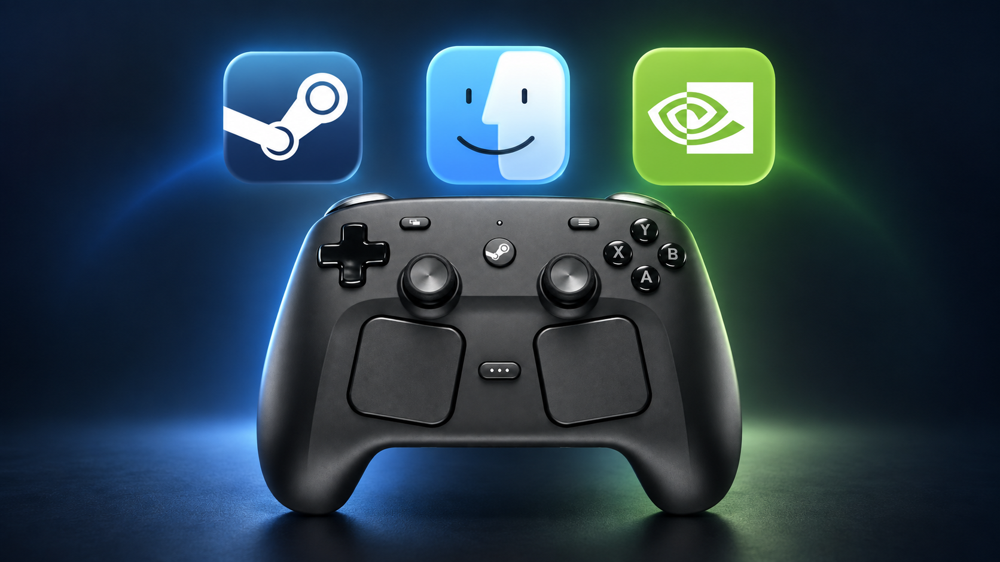

# GFN Steam Controller for macOS

<p align="center">
  
</p>

[](https://github.com/argon-analytik/gfn-steam-controller-macos/actions/workflows/ci.yml)
[](LICENSE)
[](#requirements)

If your Steam Controller works as mouse and keyboard input or in the GeForce NOW
menu but is not detected as a gamepad inside streamed games on macOS, this
project builds a separate, locally signed GFN app that routes Steam Input's
virtual Xbox controller through GFN's HID backend.

This community continuation is based on
[`mikeqwe/gfn-steam-controller-fix`](https://github.com/mikeqwe/gfn-steam-controller-fix).
It adds a Steam-managed launcher, a generated gamepad layout, Player Space gyro
aiming, guarded Steam configuration updates, and repair after supported GFN updates.
The official GFN app, Steam application binaries, and controller firmware stay
untouched; the setup changes only the dedicated shortcut and controller
profiles. SIP and other macOS protections remain enabled.

> [!IMPORTANT]
> This is an independent compatibility workaround, not an NVIDIA or Valve
> product. It patches a local copy of proprietary software. Review the code and
> the limitations below before using it.

> [!WARNING]
> Using a modified GeForce NOW client may violate the
> [GeForce NOW Terms of Use](https://www.nvidia.com/en-us/geforce-now/terms-of-use/)
> and may result in suspension or termination of the user's GFN account. Users
> are responsible for evaluating the terms and laws that apply to them.

## Tested configuration

- GeForce NOW `2.0.89.141`; earlier tests used `2.0.88.129`
- macOS `27.0.1` on a Mac mini (M4); earlier tests used `26.5.2`
- Steam Controller hardware `28de:1304`
- Steam virtual `GamePad-1` HID `045e:028e`
- GFN interface input: working
- streamed-game input: working
- vibration during streamed gameplay: working
- generated layout: left stick movement, right stick/trackpad camera, digital D-pad
- gyro: direct mouse movement in Player Space; R4 held by default, always-on optional
- wireless path: official 2.4 GHz Puck connected to the Mac over USB

These are the maintainer's gameplay results. The updated community installer
also has automated coverage for fresh installs, upgrades, and rollback; it
still needs testing on other Macs and games.

GFN `2.0.86.124`, `2.0.87.130`/`2.0.87.131`, and `2.0.88.129` remain covered by exact
instruction signatures. Other versions may work only when their input and
haptic functions match a verified signature. The builder fails closed when
they do not.

Bluetooth `28de:1303` is accepted as an additional rumble target by this fork,
but Bluetooth rumble has not received the same end-to-end gameplay validation
as the Puck path.

## What this fork adds

- A small launcher that always starts the patched GFN runtime through Steam,
  so Steam Input remains active for the complete session. A native ARM64 helper
  replaces the older `/usr/bin/arch` route that Steam could fail to launch.
- A generated Steam Controller layout with separate left/right stick outputs,
  a digital D-pad, and the right trackpad mapped to camera control.
- Fine aiming as direct mouse movement in Player Space, combining horizontal
  yaw and roll for more natural movement at different controller angles.
  Hold R4 by default, or choose always-on gyro. Normal gamepad controls remain intact.
- Automatic repair when a supported NVIDIA update removes the controller patch.
  Unknown binaries stop before replacement; active streams are not rebuilt.
- Automatic discovery of the exact non-Steam shortcut and Steam account when
  only one matching setup exists. No account identifiers are stored in this
  repository.
- Transactional profile updates with backups, drift checks, readback, and
  rollback that preserves concurrent user edits.
- Metadata-only device diagnostics and stricter filtering for Puck and
  Bluetooth rumble collections.

## Why this is needed

Steam already creates a valid virtual Xbox-compatible HID device on macOS. On
the tested setup it emits live axes and button reports correctly. Unmodified GFN
detects that device through Apple's `GameController.framework`, suppresses its
own HID path, and does not deliver usable gamepad input to the cloud game.

The patched copy disables GFN's GameController backend initialization. GFN then
opens the same Steam virtual controller through its HID backend as `045e:028e`
and forwards it as a standard gamepad.

See [Technical notes](docs/technical-notes.md) for the evidence and data flow.

## Common symptoms and questions

### GFN menu works, but streamed games do not

This is one form of the verified failure. Desktop mouse and keyboard bindings
can still control the GFN interface even when the virtual gamepad is not being
forwarded to the streamed game. The patched copy routes that gamepad through
GFN's HID backend instead.

### The controller only acts as a mouse and keyboard

First choose a Steam layout that emits gamepad controls. This project fixes the
GFN side of the path; it cannot create gamepad reports when the active Steam
layout only emits desktop input.

### Setup stops with “Shortcut identity changed”

An older installer rejected shortcuts that Steam stored as an `.app` path
instead of the executable inside it. Version 1.1.0 accepts both forms for the
expected GFN copy, while still rejecting unrelated applications.

Update this repository, quit Steam and GFN, then rerun the preview and apply:

```sh
git pull --ff-only
./configure-steam.py --account YOUR_ACCOUNT_ID
./configure-steam.py --account YOUR_ACCOUNT_ID --apply
```

Keep the existing shortcut: its AppID and controller associations are preserved.
There is no need to remove the identity check or recreate the shortcut. You can
omit `--account` when the setup is unambiguous.

### Steam Input's virtual gamepad is not detected

The tested virtual device appears as Xbox-compatible HID `045e:028e`. The
builder addresses the case where Steam creates that device successfully but
the native GFN client does not forward its reports as usable gamepad input.

### Does this require disabling System Integrity Protection?

No. SIP can remain enabled. The project patches and ad-hoc signs a separate
copy of GFN in user space; it does not install a kernel extension or DriverKit
driver.

## Requirements

- an Apple Silicon Mac;
- the official GeForce NOW app at `/Applications/GeForceNOW.app` for the
  initial installation;
- Steam Controller (2026), normally connected through its official Puck;
- Steam running with the controller configured to expose a virtual gamepad;
- Xcode Command Line Tools (`cc`, `lipo`, `nm`, `otool`, and `codesign`).

The installer may request an administrator password because the patched app is
placed in the system `/Applications` folder.

macOS requires **Input Monitoring** when the haptic bridge first opens the
physical Steam Controller. The bridge registers the request when its code
signature changes, but macOS may not show a separate permission prompt. Open
the patched app once, enable GeForce NOW under **System Settings → Privacy &
Security → Input Monitoring**, then quit and relaunch it. Without this access,
controller input still works but vibration cannot reach the physical device.

CMake, a kernel extension, a DriverKit driver, a root shell, and disabling SIP
are not required. The installer does not add a privileged helper or background
service.

## Quick start

### Steam-managed setup with the generated layout

Build the patched copy into your user Applications folder:

```sh
./build.zsh
```

In Steam, choose **Games → Add a Non-Steam Game**, select
`~/Applications/GeForceNOW-Steam-Controller.app`, and name the shortcut exactly:

```text
GeForce NOW (Steam Controller)
```

Connect the controller once so Steam creates its controller configuration.
Then quit Steam and every GeForce NOW window. Preview the changes and apply them:

```sh
./configure-steam.py
./configure-steam.py --apply
```

The tool discovers the matching local shortcut, moves the patched runtime into
its private Application Support directory, installs the small Steam launcher at
the original user-facing path, and creates the controller profiles. It refuses
ambiguous shortcuts and running Steam/GFN processes. Every write receives a
dated local backup.

For an existing Steam-managed installation, update the repository and rerun
these two configuration commands to install the new launcher and native entrypoint.
Do **not** run the default `./build.zsh` over the small launcher. If the runtime
needs rebuilding first, use the private runtime path in the
[update guide](docs/steam-managed-setup.md#updating-geforce-now).

Open the launcher for future sessions:

```sh
open "$HOME/Applications/GeForceNOW-Steam-Controller.app"
```

If Steam uses a device-specific configset, pass its existing filename during
the preview and apply steps:

```sh
./configure-steam.py --configset configset_DEVICE.vdf
./configure-steam.py --configset configset_DEVICE.vdf --apply
```

Use `--account` or `--appid` only to resolve an otherwise ambiguous local Steam
setup. These values are read locally and are never uploaded by the scripts.

To keep gyro active without holding R4, add `--gyro-activation always` to both
configuration commands. Existing profiles can be changed with `--gyro-only`;
use `--gyro-activation r4` to return to the default. Direct mouse gyro is the
default output. Games must accept mouse and gamepad input together, and their
button prompts may switch between the two.

See [Steam-managed setup and recovery](docs/steam-managed-setup.md) for the
installed paths, GFN update procedure, profile-only changes, and rollback.

### Patch-only setup

```sh
./install.zsh
open "/Applications/GeForceNOW-Steam-Controller.app"
```

The installer builds and verifies the patched copy, then places it here:

```text
/Applications/GeForceNOW-Steam-Controller.app
```

It appears in Finder's standard **Applications** folder with the display name
`GeForceNOW-Steam-Controller`, next to but distinct from the official
`NVIDIA GeForce NOW` app. Open the patched app for Steam Controller sessions;
keep the official app installed because it is the clean source for builds and
updates. If the patched copy self-updates first and becomes newer, the installer
can also use that now-unpatched copy as its read-only source.

For a low-level custom build, `build.zsh` accepts source and output paths as
positional arguments:

```sh
./build.zsh /Applications/GeForceNOW.app \
  "$HOME/Applications/GeForceNOW-Steam-Controller.app"
```

Running `build.zsh` without arguments writes to
`~/Applications/GeForceNOW-Steam-Controller.app`. This developer-oriented path
is not used by `install.zsh`.

## What the installer and builder do

1. Selects the newest safe unpatched source: normally the official GFN app, or
   a newer `GeForceNOW-Steam-Controller` copy after GFN's updater has replaced
   its patched files. The source must retain a valid deep signature from
   NVIDIA team `6KR3T733EC` and the expected GFN bundle identifier.
2. Copies that source to a staging directory.
3. Extracts the arm64 slice of `libGeronimo.dylib`.
4. Resolves `_GCDeviceInit` from the Mach-O symbol table.
5. Verifies its first eight bytes against the known instruction signature.
6. Replaces the function entry with `mov w0, #0; ret`.
7. Recombines the patched arm64 slice with the untouched x86_64 slice.
8. Makes GFN advertise rumble support and redirects its arm64 rumble callback
   to a small local HID bridge.
9. Adds the bridge as a re-exporting `libGeronimo.dylib`; the patched original
   remains beside it as `libGeronimo.original.dylib`.
10. Sets the Finder display name to `GeForceNOW-Steam-Controller` in the main
   and localized bundle metadata.
11. Ad-hoc signs the staged app and runs strict deep signature verification.
12. The installer resets a safe-to-stop resident GFN container, replaces only
    `/Applications/GeForceNOW-Steam-Controller.app`, and verifies the installed
    copy.
13. If replacement or final verification fails, the installer restores the
    previously installed patched copy.
14. If the designated code requirement changed, the installer resets only
    GFN's stale Input Monitoring decision so the next launch can register it
    again.

The installer never treats an already patched `libGeronimo.dylib` as source. It
uses a newer installed copy only after GFN's updater has removed the bridge and
restored an unpatched library. Unknown instruction bytes are still rejected
before the installed app is replaced.

The official app is never patched in place. The builder has no network access
and downloads nothing.

## Verify an installed build

```sh
./verify.zsh
```

The verifier is read-only. It confirms the patched instructions, the haptic
bridge and its re-exported original library, the Finder display name, and the
full app signature.

GFN's local log should contain these lines after launch:

```text
Device Changed 45e 28e 0 1
handleNewGamepad: standard gamepad at effective ID: 0
```

It should not contain this line for the current launch:

```text
Enabled GameController.framework backend
```

The log is normally located at:

```text
~/Library/Application Support/NVIDIA/GeForceNOW/geronimo.log
```

## Troubleshooting: input works, but vibration does not

A newly built ad-hoc signature can invalidate the previous Input Monitoring
approval. Gamepad input then continues to work, but the haptic bridge cannot
open the physical Steam Controller. `install.zsh` detects a changed designated
code requirement and normally resets this stale decision automatically.

If the prompt was dismissed or vibration still does not work:

1. Quit every GeForce NOW window.
2. Run the focused recovery utility:

```sh
./repair-input-monitoring.zsh
```

3. In the System Settings pane opened by the utility, enable **GeForce NOW**
   under **Privacy & Security → Input Monitoring**. macOS may not show a
   separate permission prompt.
4. Quit and reopen the patched app once more, then retest vibration.

The utility first verifies the installed patched app, refuses to run while a
GFN window is active, resets only `ListenEvent` for GFN's bundle identifier, and
opens both the patched app and the relevant System Settings pane. It does not
reset microphone, camera, Accessibility, or other privacy permissions. The
official and patched copies use the same NVIDIA bundle identifier, so the Input
Monitoring decision is shared between them.

## Troubleshooting: "Problem Detected" after launch

GFN leaves `GeForceNOWContainer` running after its window closes. If that
resident process belongs to the official app or another patched copy, a newly
launched copy can time out while loading the mandatory `GfnBackgroundAgent` and
show a generic **Problem Detected** dialog.

This is not part of the controller fix and does not require a special everyday
launcher. If the dialog appears:

1. Quit every GeForce NOW window.
2. Reset the resident background container:

```sh
./reset-gfn-container.zsh
```

3. Open the desired GFN app normally from Finder, Dock, or with `open`.

The reset script does not modify or launch an application. It refuses to run
while a GFN window or streamer is active, stops only same-user
`GeForceNOWContainer` processes, and verifies that the reliability lock is no
longer held. Use it only for this dialog or a confirmed cross-copy container
conflict.

## Updating GeForce NOW

The steps below apply to the patch-only `/Applications` installation. For the
Steam-managed launcher and generated layout, follow
[Steam-managed setup and recovery](docs/steam-managed-setup.md#updating-geforce-now).

1. Let either the official or patched copy finish its normal GFN update.
2. Quit every GeForce NOW window.
3. Run `./install.zsh` again.
4. The installer uses the official app when it is current. If the patched copy
   self-updated to a newer version and lost its patch, that copy is used as the
   read-only source instead.
5. Open `/Applications/GeForceNOW-Steam-Controller.app` normally.
6. If the installer reset Input Monitoring, open GFN once, enable it under
   **System Settings → Privacy & Security → Input Monitoring**, quit GFN, and
   open it once more. macOS may not show a separate permission prompt.
7. Test the GFN interface, one streamed game, and vibration.

The installer temporarily preserves the previous patched copy and removes that
backup only after the newly installed copy passes verification. Direct custom
builds made with `build.zsh` retain their previous output as
`GeForceNOW-Steam-Controller.app.previous-YYYYMMDD-HHMMSS`.

If NVIDIA changes `_GCDeviceInit`, the builder stops on `unexpected
instructions`. Do not weaken that check blindly; inspect and document the new
function before updating the signature.

## Limitations

- The fix disables `GameController.framework` for **all controllers used by the
  patched GFN copy**, not only Steam Controller. Other controllers may lose
  platform-specific behavior.
- Only arm64 is patched. The preserved x86_64 slice does not contain the fix.
- The haptic bridge targets the physical Steam Controller `28de:1304` and GFN
  controller ID 0. It maps the two main rumble motors; trigger-specific haptics
  are currently ignored.
- Vibration is sent directly to the physical controller. Other gamepads keep
  using GFN's stock HID behavior and are outside the haptic bridge's scope.
- GFN's self-updater may replace patched files. Re-run the builder and verifier
  after any update or unexpected regression.
- The instruction signature is version-sensitive by design.
- Ad-hoc signing may cause macOS to ask for permissions again or treat the copy
  as a different local build.

## Uninstall

The command below removes the patch-only `/Applications` installation. The
Steam-managed setup has a separate rollback because it also owns a Steam
shortcut and controller profiles; see
[Steam-managed setup and recovery](docs/steam-managed-setup.md#rolling-back-the-steam-managed-setup).

Quit every GeForce NOW window, then run:

```sh
./uninstall.zsh
```

The script removes only
`/Applications/GeForceNOW-Steam-Controller.app`. It does not remove or modify
the official GFN app, Steam configuration, shared GFN user data, permissions,
drivers, services, or daemons.

## Development

```sh
make check         # syntax check, compile with warnings as errors, unit tests
make install-app   # build, verify, and install into /Applications
make uninstall-app # remove only the installed patched copy
make repair-input-monitoring # reset stale vibration permission and relaunch
make build-app     # low-level build into the user Applications folder
make verify-app    # verify the system-installed patched copy
make device-probe  # read matching controller metadata without opening devices
make clean
```

Read [CONTRIBUTING.md](CONTRIBUTING.md) before submitting changes. Never commit
NVIDIA binaries, application bundles, authentication material, or unsanitized
GFN logs.

## License and trademarks

The original code in this repository is available under the [MIT License](LICENSE).
GeForce NOW, NVIDIA, Steam, Valve, Xbox, Apple, and macOS are trademarks of
their respective owners. See [NOTICE](NOTICE).
